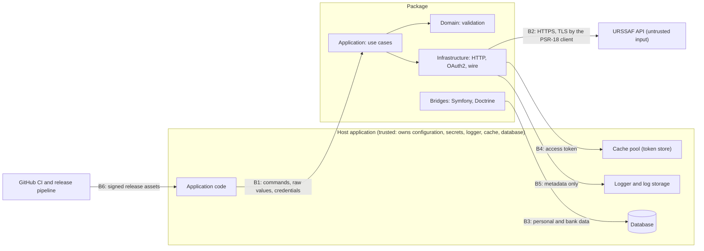

# Security assurance case

Status: **complete** (every mechanism below points to the code that implements it; no independent security review has
been performed yet, see [Residual risks](#8-residual-risks)). This document argues why the security requirements of
`thebeardedbear/urssaf-tierce-declaration-auto-entrepreneur` are met. Each claim names the file that implements it and,
where it exists, the decision record; the tests live in `tests/` under the same relative path as the class they cover.

The package is a library, so part of the security of a deployment belongs to the host application (see
[Assumptions on the host](#7-assumptions-on-the-host-application)).

Reporting a vulnerability: [SECURITY.md](../../SECURITY.md).

## 1. What is protected

The package acts, on behalf of auto-entrepreneurs, with the URSSAF "API Tierce Déclaration auto-entrepreneur": it
notifies third-party declaration mandates, estimates and declares turnover, orders the SEPA payment of contributions
and manages SEPA mandates, authenticating with OAuth2 client credentials.

| Asset | Where it lives | Sensitivity |
|---|---|---|
| OAuth2 `client_id` / `client_secret` of each tenant | Host configuration or `CredentialsProvider`; in memory in the credentials object | Secret |
| Access token (scope `tiersdecl.ae`) | `TokenStore` (PSR-6 / PSR-16 cache pool), in memory during a call | Secret, short lived |
| Identification of the auto-entrepreneur: SIRET, birth date (sent with the mandate notification and cancellation) | Domain value objects, host database (Doctrine mapping), sent to URSSAF | Personal data (GDPR) |
| SEPA data: IBAN, BIC, account holder, address (payment order, mandate registration and listing) | Domain value objects, in memory during the call only: never persisted, never logged (ADR 0010); sent to URSSAF | Personal and financial data (GDPR) |
| RUM of a SEPA mandate | Payment records, integration events, sent to URSSAF | URSSAF technical identifier |
| Turnover declarations, estimated and due amounts, payment orders (`montant`, `periode`, `certificat`, `idDeclaration`, `idTelepaiement`) | Domain aggregates, host database, sent to URSSAF | Integrity critical (social contributions, direct debit) |
| Integration events (outbox) | Outbox table or in memory | Technical identifiers only, no personal or bank data |
| Source code and releases | GitHub repository, Packagist, release assets | Integrity critical (supply chain) |

## 2. Security requirements

| ID | Requirement |
|---|---|
| SR1 | Credentials and tokens are never persisted by the package, never logged, never present in exception messages, and masked when dumped. |
| SR2 | Personal and bank data (SIRET, birth date, IBAN, BIC, holder, address) is never logged by the package, never present in exception messages or integration events, masked when dumped, and erasable (GDPR). |
| SR3 | The declarations and amounts sent to URSSAF are what the host asked for: validated, exactly represented (whole euros, no float), and not duplicated by retries. |
| SR4 | A payment order (`POST /payer`, 060) is never sent twice by the package (not even after a 401: the token is invalidated, the payment is settled `invalid_credentials` and requeued by the host, ADR 0003): the API has no idempotency key and no status endpoint, so an ambiguous outcome is reported as `outcome_unknown` and left to the host. Other writes with an unspecified effect (030, 031, 050, 070, 071) are not resent either unless the host opts in (`retrySafeWrites`, ADR 0003). |
| SR5 | Everything received from URSSAF is untrusted: parsed strictly, never executed or deserialised into arbitrary objects, and a malformed response fails closed. |
| SR6 | Requests are authenticated and sent to the intended URSSAF host; one tenant can neither use nor see another tenant's credentials, tokens or records. |
| SR7 | A failure of URSSAF or of the network degrades gracefully: bounded retries, an explicit "may have reached URSSAF" signal, transport errors sanitised, no data loss, no unbounded loop. |
| SR8 | The code and the release artefacts come from the maintainers' reviewed and tested commits and can be verified by consumers. |

## 3. Threat model

| Actor | Capability considered | Main threats |
|---|---|---|
| Network attacker | Observes or tampers with traffic between the host and URSSAF | Eavesdropping on tokens, IBAN or birth dates, response tampering, downgrade |
| Malicious or compromised URSSAF endpoint (or a proxy configured as such) | Returns arbitrary bodies, statuses and sizes; the two published contracts already differ | Injection through response fields, deserialisation, resource exhaustion, secrets in error text |
| Host application bug or misconfiguration | Controls configuration, logger, cache, database, listeners | Secrets in clear configuration, `http://` base URI, shared cache, verbose logs, no retention policy, auto-resend of writes enabled blindly |
| Other tenant of a multi-tenant host | Uses the same host application | Cross-tenant access to records, tokens or credentials |
| Hostile or faulty user-supplied data | SIRET, IBAN, holder and address reach the package through the host | Malformed values reaching URSSAF or the database; a wrong IBAN on a mandate |
| Retry or timeout on a non-idempotent write | A transport failure after the request left | A duplicated payment order or declaration |
| Malicious contributor, poisoned dependency, abused CI token | Pull request, dependency update, workflow permissions | Backdoor in the package, secret exfiltration from CI, tampered release |

Out of scope: compromise of the host server or the database server itself, and the security of the URSSAF platform
(see [SECURITY.md](../../SECURITY.md#scope)).

## 4. Trust boundaries

| Boundary | What crosses | Control in the package |
|---|---|---|
| B1 host to package | Commands and raw values | Value objects validate at construction, with stable violation codes and no raw value in messages; credentials only through `CredentialsProvider` (`src/Application/Port/CredentialsProvider.php`); credentials refuse serialisation and mask the secret (`src/Application/Port/Credentials.php`, `CredentialsNotSerializable.php`) |
| B2 package to URSSAF | HTTPS requests with a bearer token; untrusted responses (object or list error payloads, wrapped or direct bodies) | TLS and certificate verification delegated to the PSR-18 client; strict JSON decoding and typed mapping; transport errors sanitised (`src/Infrastructure/Urssaf/Http/JsonApiClient.php`, `Http/TransportError.php`, `Wire/JsonDecoder.php`, `Wire/Payload.php`) |
| B3 package to database | Personal data at rest (SIRET, birth date, declaration and payment records); never bank data (IBAN, BIC, holder, address) | Doctrine named parameters, a dedicated birth-date column type the host can replace to encrypt, no bank column, erasure of an account (ADR 0010, 0016, 0017; `src/Bridge/Doctrine/Type/BirthDateType.php`, `Repository/AggregateStore.php`, `src/Application/Command/ForgetAccountHandler.php`) |
| B4 package to cache | Access token | Cache key derived from a hash of environment, base URI and client id, never the secret; item expires with the token; a malformed item is a cache miss (`src/Infrastructure/Urssaf/Http/OAuth2TokenProvider.php`, `src/Infrastructure/TokenStore/CachedAccessToken.php`, `Psr6TokenStore.php`) |
| B5 package to logs | Technical metadata | Fixed set of fields: operation number, HTTP status, URSSAF error codes, duration, exception class; no body, path, query string, token or personal data; the SIRET only on opt-in (`log_siret`, ADR 0010; `JsonApiClient.php`, `src/Infrastructure/Logging/PsrLoggerFailureReporter.php`) |
| B6 pipeline to consumers | Releases | Pinned actions, least-privilege tokens, SLSA provenance, checksums |

Inside the package, Deptrac enforces the layers that separate these zones (`deptrac.yaml`: Domain, Contract,
Application, Infrastructure, Testing, Standalone and the two bridges, ADR 0000).

## 5. Secure design principles

Saltzer and Schroeder principles mapped to the design. The `Where` column names the files and the decision record.

| Principle | How it is applied | Where |
|---|---|---|
| Economy of mechanism | No third-party runtime code: `require` lists only PHP, PSR interfaces and PHP extensions; the HTTP client, cache and logger come from the host. A small own JSON encoder refuses floats. | `composer.json`, `src/Infrastructure/Urssaf/Wire/JsonEncoder.php`, ADR 0000 |
| Fail-safe defaults | The environment is explicit, the production environment is never implicit, the default logger is a `NullLogger`, a malformed cached token is a cache miss, writes with an unspecified effect are not resent unless the host opts in (`retrySafeWrites`). | `src/Infrastructure/Urssaf/ApiConfiguration.php`, `src/Application/Port/OperationRetryClass.php`, `src/Infrastructure/Urssaf/UrssafGatewayFactory.php`, ADR 0003, ADR 0011 |
| Complete mediation | Every URSSAF call goes through one HTTP client class (token, status mapping, sanitised errors). Value objects have private constructors, so every instance went through validation. | `src/Infrastructure/Urssaf/Http/JsonApiClient.php`, `src/Domain/**`, ADR 0000 |
| Open design | Open source, documented protocol mapping, public quality thresholds. Nothing relies on secrecy of the code. | `README.md`, `docs/`, `CONTRIBUTING.md` |
| Separation of privilege | Strict layers: Domain and Contract depend on nothing, Application on Domain and Contract, Infrastructure and bridges on the layers below. Integration events are separate scalar classes. | `deptrac.yaml`, ADR 0000 |
| Least privilege | Credentials fetched per tenant on demand; a single OAuth2 scope (`tiersdecl.ae`); CI workflows default to `contents: read` and elevate per job. | `src/Infrastructure/Urssaf/UrssafEndpoints.php`, `.github/workflows/*.yml`, ADR 0012 |
| Least common mechanism | Token cache key per environment, base URI and client id; locks and repository queries per tenant (`src/Infrastructure/Urssaf/Http/OAuth2TokenProvider.php`, `src/Infrastructure/RateLimiter/SlidingWindowRateLimiter.php`, `src/Bridge/Symfony/Lock/OperationLocks.php`, Doctrine repositories filtered by `tenant_id`). | ADR 0012, ADR 0013 |
| Psychological acceptability | The secure path is the default path: secrets through the host's secret store, one factory to build the gateway, an installation diagnostic and an erasure command (`urssaf:tdae:check`, `urssaf:tdae:account:forget`). | `src/Standalone/UrssafTierceDeclarationAutoEntrepreneurBuilder.php`, `src/Bridge/Symfony/Diagnostic/`, `docs/doctrine.md`, ADR 0015, ADR 0017 |
| Defence in depth | Secrets and personal or bank data are masked in `__debugInfo()`, marked `#[SensitiveParameter]`, not serialisable for credentials, not logged, absent from exception messages and from integration events. | `src/Application/Port/Credentials.php`, `src/Domain/Sepa/Iban.php`, `Bic.php`, `AccountHolder.php`, `SepaMandateAddress.php`, `src/Domain/Account/Siret.php`, `src/Contract/Event/`, ADR 0010, ADR 0014 |
| Fail securely | HTTP errors become typed exceptions carrying the status and the URSSAF error code. An unexpected status or body raises `UnexpectedUrssafResponse` instead of being interpreted. One replay after a 401 (never on 060) and no other automatic retry in the client. | `src/Infrastructure/Urssaf/Http/JsonApiClient.php`, `src/Infrastructure/Urssaf/Exception/UnexpectedUrssafResponse.php`, `src/Infrastructure/Urssaf/Wire/ErrorClassifier.php`, ADR 0002, ADR 0005 |
| Integrity by construction | Amounts are whole euros (`int`, no float anywhere in the domain). The payment order is recorded as attempted before the call and is never resent: a transport failure after the request left yields `outcome_unknown` and the host reconciles through the account and the period, since the API has no status endpoint. Declaration and mandate writes follow the opt-in rule of ADR 0003. | `src/Domain/Money/Euros.php`, `src/Application/Service/PaymentSubmitter.php`, `src/Domain/Payment/PaymentRecord.php`, ADR 0003, ADR 0007, ADR 0009 |

## 6. Common implementation weaknesses and how they are countered

The *Where, verified by* column names the implementing files and the tests (`tests/Unit/...` mirrors `src/...`).

| Weakness (OWASP Top 10 2021 / CWE) | Countermeasure | Where, verified by |
|---|---|---|
| SQL injection (A03, CWE-89) | DQL with named parameters (`setParameter`); the only concatenated parts are entity class constants, never request data. | `src/Bridge/Doctrine/Repository/*.php`; `tests/Functional/Doctrine`, PHPStan Doctrine extension |
| HTTP, header and form injection (CWE-93, CWE-113) | Query string (accounts, mandate operations, SEPA path segments `siret` and `rum`) and token body built with RFC 3986 encoding; paths are constants plus encoded segments; header values come from configuration only. | `src/Infrastructure/Urssaf/Wire/ApiPaths.php`, `QueryEncoding.php`, `src/Infrastructure/Urssaf/Http/ApiRequest.php`, `UrssafEndpoints.php`; `tests/Unit/Infrastructure/Urssaf` |
| JSON injection (CWE-116) | Every key and string goes through `json_encode` with `JSON_THROW_ON_ERROR`; only null, bool, int, string, arrays and forced `{}` objects are accepted; floats are refused. | `src/Infrastructure/Urssaf/Wire/JsonEncoder.php`, `EurosEncoding.php`; unit tests |
| Sensitive data exposure (A02, CWE-200, CWE-532) | Logs hold the operation number, status, error codes, duration and exception class; bodies, paths, query strings and tokens are never logged. Exception messages hold violation codes and statuses, never raw values (SIRET, birth date, IBAN, holder, address). Transport errors are sanitised so that a PSR-18 exception message cannot leak a URL with a query string. Debug output is masked. Integration events carry identifiers only. | `JsonApiClient.php`, `Http/TransportError.php`, `src/Domain/Exception/`, `src/Contract/Event/`, ADR 0010, ADR 0014; unit tests (the `#[SensitiveParameter]` attributes are asserted by reflection) |
| Cleartext transmission, improper certificate validation (CWE-319, CWE-295) | Default base URIs are `https://` (`src/Infrastructure/Urssaf/Environment.php`). The package never disables verification. An overridden base URI must be an absolute `http(s)` URI without query or fragment (`ApiConfiguration`); **`http://` is not refused**: using HTTPS is the host's responsibility (assumption 2). | `src/Infrastructure/Urssaf/Environment.php`, `ApiConfiguration.php` |
| Insecure deserialisation (A08, CWE-502) | Responses are decoded with `json_decode` into arrays, never `unserialize`; a cached token must have the exact array shape; credentials refuse serialisation; the outbox stores scalar events with PHP `serialize()` and reads them back with `unserialize()` restricted to the twelve event classes (`allowed_classes`, ADR 0014; the column is written by the package only). | `src/Infrastructure/Urssaf/Wire/JsonDecoder.php`, `src/Infrastructure/TokenStore/CachedAccessToken.php`, `src/Contract/Event/IntegrationEventCodec.php`; unit tests |
| Improper input validation (CWE-20) | Anchored regexes with the `D` modifier, bounded lengths, SIRET (14 digits), the published lengths of the bank fields (no IBAN or BIC checksum or pattern is published: URSSAF checks them, ADR 0011), dates, periods (monthly or quarterly sum type), whole-euro amounts; response fields read through one typed reader; the two contracts (production 1.5.1, sandbox 1.5.0) are tolerated, not trusted. | `src/Domain/**`, `src/Infrastructure/Urssaf/Wire/Payload.php`, ADR 0004, ADR 0006, ADR 0011; unit tests |
| Numeric errors (CWE-190, CWE-681) | Whole euros as `int` with range limits; no float on the encoding path; negative or non-finite amounts rejected; the rounding rule of the specification is documented, not applied silently. | `src/Domain/Money/Euros.php`, `src/Infrastructure/Urssaf/Wire/EurosEncoding.php`, ADR 0007; unit tests |
| Duplicate side effects (CWE-837, business logic) | `POST /payer` is never resent; an atomic claim precedes any URSSAF write; an ambiguous failure is `outcome_unknown`; writes with an unspecified effect (030, 031, 050, 070, 071) are resent only on explicit opt-in. Safe operations (020, 040, 075 and the token request) may be retried. | `src/Application/Service/PaymentSubmitter.php`, `DeclarationSubmitter.php`, `src/Application/Port/OperationRetryClass.php`, `src/Bridge/Doctrine/Repository/AggregateStore.php` (atomic claim), ADR 0003; unit and functional tests |
| Hard-coded credentials (CWE-798) | None in the repository; secrets come from the host; fixtures use fictitious values or the official examples; GitHub secret scanning with push protection is enabled (repository setting, to be confirmed when the repository is public). | `CONTRIBUTING.md`, repository settings |
| Weak randomness (CWE-330, CWE-338) | No identifier used as a security token is generated by the package; the URSSAF identifiers (`certificat`, `idDeclaration`, `idTelepaiement`, `rum`) are opaque values received from URSSAF. Local ids use `random_bytes()`. | `src/Infrastructure/Id/SecureRandomBytes.php`, `RandomUuidGenerator.php`; review: `src` contains no `rand`, `mt_rand` or `uniqid` |
| Authentication failures (A07) | Client-credentials flow; the token is renewed a safety margin early; a 401 invalidates the cached token and triggers one replay (none on 060, which goes to `invalid_credentials`); failures on the token endpoint raise `UrssafAuthenticationFailed` and are not retried; a record in `invalid_credentials` state is not retried until requeued (`RequeueAfterInvalidCredentials`). | `src/Infrastructure/Urssaf/Http/OAuth2TokenProvider.php`, `JsonApiClient.php`, `src/Application/Command/RequeueAfterInvalidCredentialsHandler.php` |
| Broken access control, tenant isolation (A01, CWE-639) | Credentials resolved per tenant; repository queries scoped by `TenantId`; locks and rate limits per tenant. | `src/Application/Port/CredentialsProvider.php`, `src/Bridge/Doctrine/Repository/*.php`, `src/Bridge/Symfony/Lock/OperationLocks.php`, `SlidingWindowRateLimiter.php`, ADR 0012; repository contract tests (`tests/*/Repository`) |
| Resource exhaustion (CWE-400, CWE-770) | Client timeout, in-process rate limiter for the quota of 300 requests per minute per API client (HTTP 429 handled with `Retry-After` in delta-seconds only), JSON depth limit, one replay at most, non-blocking locks. The response body size is not capped by the package (residual risk, section 8). | `src/Infrastructure/RateLimiter/SlidingWindowRateLimiter.php`, `Http/RetryAfter.php`, `Wire/JsonDecoder.php` (depth 512), ADR 0013 |
| Vulnerable and outdated components (A06) | No third-party runtime code. Development tooling: `composer audit` in CI and `make composer-checks`, `roave/security-advisories`, Dependabot weekly (Composer and GitHub Actions), committed `composer.lock`. | `composer.json`, `.github/dependabot.yml`, `.github/workflows/ci.yml` |
| Supply chain, integrity failures (A08) | Actions pinned to a commit SHA; `contents: read` by default, elevated per job; no `pull_request_target`; CodeQL for workflows; OpenSSF Scorecard; releases carry `SHA256SUMS` and a SLSA provenance attestation; DCO sign-off on every commit; SPDX headers checked in CI. Branch protection on `main` (pull requests, status checks, linear history) is a repository setting to confirm when the repository is public. | `.github/workflows/*.yml`, `SECURITY.md`, `CONTRIBUTING.md` |
| Logging and monitoring failures (A09) | Metadata-only logs on a dedicated channel; a failure reporter for post-commit failures; diagnostics. | `src/Infrastructure/Logging/PsrLoggerFailureReporter.php`, `src/Bridge/Symfony/Diagnostic/`, ADR 0015 |
| SSRF (A10, CWE-918) | The path is a constant; only the base URI is variable and it is operator configuration, never derived from URSSAF responses or user input. | `src/Infrastructure/Urssaf/UrssafEndpoints.php`, ADR 0002 |
| Insecure design (A04) | The threat model above, layers enforced by tooling, local lifecycles of accounts, mandates, declarations and payments, erasure refused while a submission is in flight or, without opt-in, while an outcome is unknown. | `deptrac.yaml`, `src/Application/Command/ForgetAccountHandler.php`, `src/Application/Exception/AccountErasureRefused.php`, ADR 0009, ADR 0017 |

### Tools that verify these countermeasures

| Tool | What it checks | Where it runs |
|---|---|---|
| PHPStan level max (strict, deprecation, Doctrine, Symfony, PHPUnit rules) | Type safety, unsafe patterns | CI `phpstan`, `make phpstan` |
| Mago lint and analyze | Static analysis | CI `mago`, `make mago` |
| Deptrac | Layer boundaries inside the package | CI `deptrac`, `make deptrac` |
| PHPUnit with 100% line, method and class coverage and at least 96 % branch coverage | Behaviour including failure paths | CI `coverage`, `bin/check-coverage`, `make coverage-branches` |
| Infection with 100% MSI | The tests detect behaviour changes | CI `infection`, `make infection` |
| SPDX header check and DCO check | Licence provenance of files and commits | `bin/check-spdx` (`make guard`), `bin/check-dco` |
| SonarQube Cloud (when enabled by the repository variable) | Vulnerabilities, security hotspots | CI `sonarcloud` |
| `composer audit`, `roave/security-advisories`, Dependabot | Known vulnerable dependencies | CI `composer-checks`, Dependabot |
| CodeQL on the GitHub Actions workflows | Workflow injection, excessive permissions | `.github/workflows/codeql.yml` |
| OpenSSF Scorecard | Supply-chain practices | `.github/workflows/scorecard.yml` |
| SLSA provenance attestation and `SHA256SUMS` | Provenance of release archives | `.github/workflows/release.yml` |
| GitHub secret scanning with push protection | Committed secrets | Repository setting |

## 7. Assumptions on the host application

The assurance above holds if the host application:

1. keeps `client_secret` in a secret store or environment variable (a literal in committed configuration ends up in
   the compiled container) and restricts who can read it;
2. provides a PSR-18 client that verifies TLS certificates, with safe redirect behaviour, and does not override the
   base URI with a non-HTTPS URL outside tests;
3. uses a token cache pool private to the application: the access token is stored there in clear for its lifetime;
4. protects the database (access control, encryption at rest, optionally column encryption through the dedicated
   column type of the birth date and the JSON result columns), bounds the retention of backups and applies a retention and erasure
   policy to personal data;
5. does not log request or response bodies or query strings at its own HTTP-client level, and does not put personal or
   bank data in the messages of exceptions raised by its own listeners and sinks;
6. treats `outcome_unknown` of a payment order as an open case to reconcile (account and period), never as a failure to
   retry blindly, and enables `retrySafeWrites` only after checking in the sandbox that the write is safe to repeat.

## 8. Residual risks

No independent security review has been performed yet; the case rests on the design decisions, the code and the quality
gates. Known limits:

- the API offers no idempotency key and no status endpoint, so an ambiguous payment outcome cannot be resolved by the
  package, only reported and left to an operator (ADR 0003);
- the production and sandbox contracts differ and the sandbox token host is not published, so some behaviours can only
  be settled by the contract tests, which have not run against the sandbox yet (docs/api-reference.md §5);
- the response body size is not capped by the package (JSON depth is limited to 512): a malicious endpoint or proxy could
  send a very large body; bound it in the PSR-18 client of the host;
- an overridden base URI may use `http://`: the package validates the shape of the URI but does not refuse the scheme
  (assumption 2 of the host);
- the in-process rate limiter does not see other processes (ADR 0013): a host that runs several workers supplies a shared
  limiter;
- the outbox column holds PHP-serialised scalar events: deserialisation is restricted to the event classes, but a host
  that lets a third party write to that table should not relay it;
- the access token sits in clear in the host's cache pool for its lifetime (assumption 3).

Findings of a dated security review will be listed here and linked from [SECURITY.md](../../SECURITY.md) once it exists
(a step before the first release, see [docs/roadmap.md](../roadmap.md)).

## 9. Keeping the case valid

The case is revisited when a change touches a trust boundary: a new outbound call, a new persisted field holding
personal or bank data, a new logging statement, a new dependency, a new workflow permission. Pull requests run the
full quality gate (`make ci`). Every mechanism above names its file; a change that moves or removes one updates this document in the same pull request.
The status changes to *reviewed* once an independent security review has been done.
